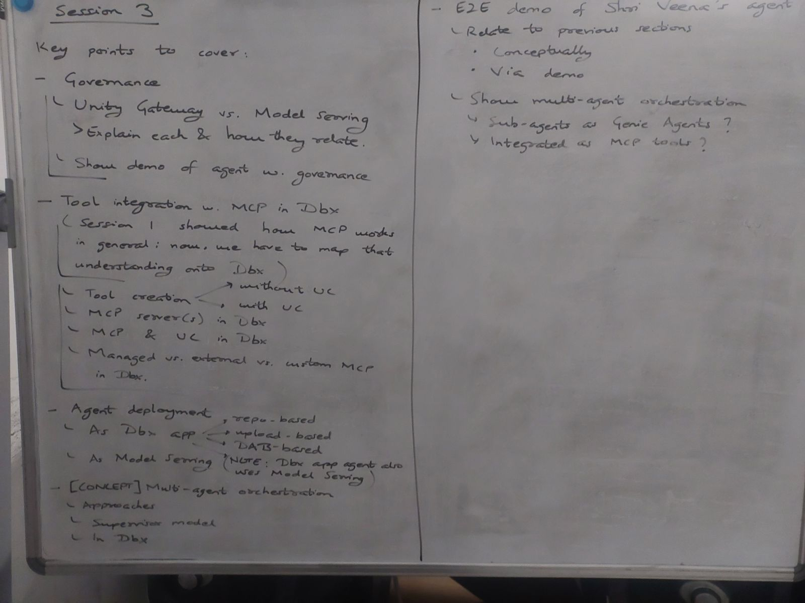

<h1>Demo Plan V5</h1>

> Human + AI made, based on [`demo-plan-v4.md`](./demo-plan-v4.md)

---

**Contents**:

- [Abbreviations](#abbreviations)
- [Session 1](#session-1)
- [Session 2](#session-2)
- [Session 3](#session-3)

---

# Abbreviations

| Abbreviation | Full form |
| --- | --- |
| UC | Unity Catalog |

# Session 1

Whiteboard for sessions 1 and 2

> **NOTE [as of 2026-10-17]**:
> 
> - Initially intended for sessions 1 and 2
> - Was mostly fit into session 1 with some modifications:
>   - E2E agentic app demo in Databricks not shown
>   - Skipped the model versions tracking demo for MLFlow
>   - Agent evaluation was just introduced + basic demo; deeper-dive needed

---

Key points to note:

- Realistic/diverse examples need not be shown in demo
  > Demo can have a toy example, with other examples stated.
- Aim to go into more detail with practical examples
  > So details do not seem free-floating. E.g.:
  > 
  > - Span types and autologging explained in demo
  > - MCP invocations and calls shown in demo

---

Carried over from V4:

**Recognise** (recorded overview):

| Code | Description |
| --- | --- |
| R1 | Briefly go over what tracing, evaluation, versioning, governance and deployment are each for. |
| R2 | Point to where a tool call, a wrong answer, a version change and a permission difference show up in a running agent. |

**Explain** (deep dive):

| Code | Description |
| --- | --- |
| E1 | Explain what an agent is and how tool calling works, and read a tiny agent loop. |
| E2 | Explain trace vs span, the span types, and automatic vs custom spans. *(Lab: add `@mlflow.trace` to a function and find your span.)* |
| E3 | Describe host, client and server, the 3 MCP primitives (tools, resources, prompts), and the 2 transports (STDIO, Streamable HTTP). |

> **NOTE**: E1 is not explicitly covered in the whiteboard, but it is cheap and effective to add with the MLflow demos, as an agent loop enriches the demo while explaining a key concept that is relevant overall. Also note that E1 will partially be theoretically covered in the initial demo that establishes the point of reference.

# Session 2
Key ideas:

- Continue agent evaluation
  - [Evaluation-driven development](../agent-evaluation.md#evaluation-driven-development)
    > To give a general context for the following.
  - [Overview of MLflow's gen-AI evaluation framework](../agent-evaluation.md#overview-of-mlflows-gen-ai-evaluation-framework)
  - [Core components of MLflow's evaluation architecture](../agent-evaluation.md#core-components-of-mlflows-evaluation-architecture)
  - [MLflow evaluation workflow](../agent-evaluation.md#mlflow-evaluation-workflow)
  - [Observability via MLflow Tracing for evaluation](../agent-evaluation.md#observability-via-mlflow-tracing-for-evaluation)
  - [Scorers for evaluation via MLflow](../agent-evaluation.md#scorers-for-evaluation-via-mlflow)
  - [Iterative development of custom judges/scorers](../agent-evaluation.md#iterative-development-of-custom-judgesscorers)
- Details on observability via MLflow
  - [About MLflow Tracing](../agent-deployment-on-databricks.md#about-mlflow-tracing)
  - [Adding tracing to agents](../agent-deployment-on-databricks.md#adding-tracing-to-agents)
- Introduce governance:
  > Relevant for:
  >
  > - Traces in production
  > - Production monitoring via Unity Gateway
  - Unity Gateway
  - UC
- Specifics on observability and monitoring in Databricks
  - [MLflow Tracing in Databricks](../agent-evaluation.md#mlflow-tracing-in-databricks)
  - [Traces in production (in Databricks)](../agent-deployment-on-databricks.md#traces-in-production-in-databricks)
  - [Production monitoring via Unity Gateway integration](../agent-evaluation.md#production-monitoring-via-unity-gateway-integration)

---

**Demo plan** (Python wiki agent):

> **Approach**: One small agent, one new concept per demo. Each demo ends with a "break it" moment that motivates the next. Notebook flow: concept -> code -> what to look at in the UI -> break it.

**The agent**:

- **Task**:   Answer beginner Python questions from a wiki of about 10 short pages
- **Tool**:   `search_wiki(query)`
  - Giving `RETRIEVER` and `TOOL` spans
  - Without being overwhelming
- **LLM**:   A Databricks-hosted foundation model via a serving endpoint
- **Shared eval questions** (about 10, reused in every demo):
  - Covered by the wiki
  - Not covered by the wiki (triggers an ungrounded answer)
  - Out of scope (e.g. Java generics)
  - Adversarial ("ignore your instructions...")

> **WHY**: Reusing the same agent and questions lets learners compare results across demos.

**Demos**:

| Code | Demo | What it shows | "Break it" moment |
| --- | --- | --- | --- |
| D0 | Baseline agent | Plain agent, no tracing | You cannot tell *why* an answer came out as it did |
| D1 | Tracing | `@mlflow.trace`, auto spans from the LLM client, a manual span, reading the span tree | The retriever returned no pages, so the answer is ungrounded |
| D2 | First evaluation | Eval dataset, `predict_fn`, `mlflow.genai.evaluate()`, built-in judges (`Correctness`, `Safety`, `RetrievalGroundedness`), `Feedback` rationales | Built-ins cannot check that answers include a runnable code example |
| D3 | Custom scorers | Guideline judge, deterministic `@scorer`, `make_judge()` in one `evaluate()` call | Do the judges agree with a human? |
| D4 | Judge iteration | Human feedback on traces, trace tags for failure modes, judge alignment | Why judges need validation |
| D5 | Governance intro | UC (catalog/schema, register the agent as a UC model, grant/revoke, lineage), then Unity Gateway (guardrails, rate limit, usage tracking, `use_ai_gateway=True`) | Trip the rate limit; a guardrail blocks the adversarial prompt |
| D6 | Production | Traces in UC Delta tables, production monitoring (`register()` then `start()`), backfill, archival, inference tables, production failures feed back into the eval dataset | A production failure becomes a new eval row |

> **NOTE**: D1 comes before D2 (the reverse of the key-ideas order above), because learners need to see a trace before an evaluation makes sense.

**Practical notes**:

- **Deployment**: Develop in notebooks; deploy to Model Serving for D5-D6 (automatic tracing, clearest path through Unity Gateway)
- **UC trace location**: If D6 stores traces in UC, create the experiment with the trace location **at creation**. Binding cannot be added or changed later.
- **Availability checks** before D5-D6:
  - Production monitoring, backfill and archival are Beta
  - UC trace storage needs MLflow >= 3.14, a SQL warehouse with `CAN USE`, a supported region, and an existing catalog and schema
- **Gateway caveat**: Legacy AI Gateway does not support rate limiting or guardrails on Databricks *agents* endpoints. Run the gateway demo against the model endpoint the agent calls, not the agent endpoint.

# Session 3

Whiteboard for session 3

