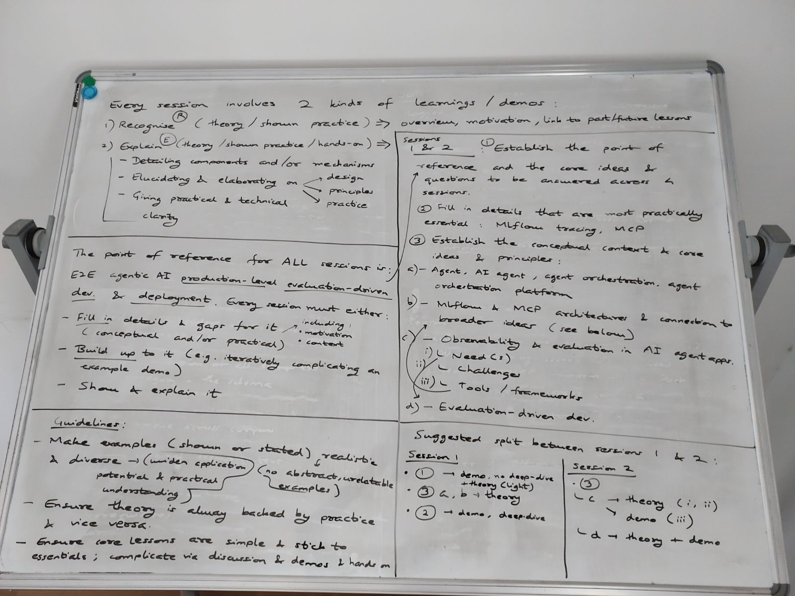

<h1>Demo Plan V5</h1>

> Human-made, based in the largely AI-generated [`demo-plan-v4.md`](./demo-plan-v4.md)

---

# Sessions 1 and 2

Whiteboard for sessions 1 and 2

---

Key points to note:

- Realistic/diverse examples need not be shown in demo
  > Demo can have a toy example, with other examples stated.
- Aim to go into more detail with practical examples
  > So details do not seem free-floating. E.g.:
  > 
  > - Span types and autologging explained in demo
  > - MCP invocations and calls shown in demo

---

Carried over from V4:

**Recognise** (recorded overview):

| Code | Description |
| --- | --- |
| R1 | Briefly go over what tracing, evaluation, versioning, governance and deployment are each for. |
| R2 | Point to where a tool call, a wrong answer, a version change and a permission difference show up in a running agent. |

**Explain** (deep dive):

| Code | Description |
| --- | --- |
| E1 | Explain what an agent is and how tool calling works, and read a tiny agent loop. |
| E2 | Explain trace vs span, the span types, and automatic vs custom spans. *(Lab: add `@mlflow.trace` to a function and find your span.)* |
| E3 | Describe host, client and server, the 3 MCP primitives (tools, resources, prompts), and the 2 transports (STDIO, Streamable HTTP). |

> **NOTE**: E1 is not explicitly covered in the whiteboard, but it is cheap and effective to add with the MLflow demos, as an agent loop enriches the demo while explaining a key concept that is relevant overall. Also note that E1 will partially be theoretically covered in the initial demo that establishes the point of reference.

